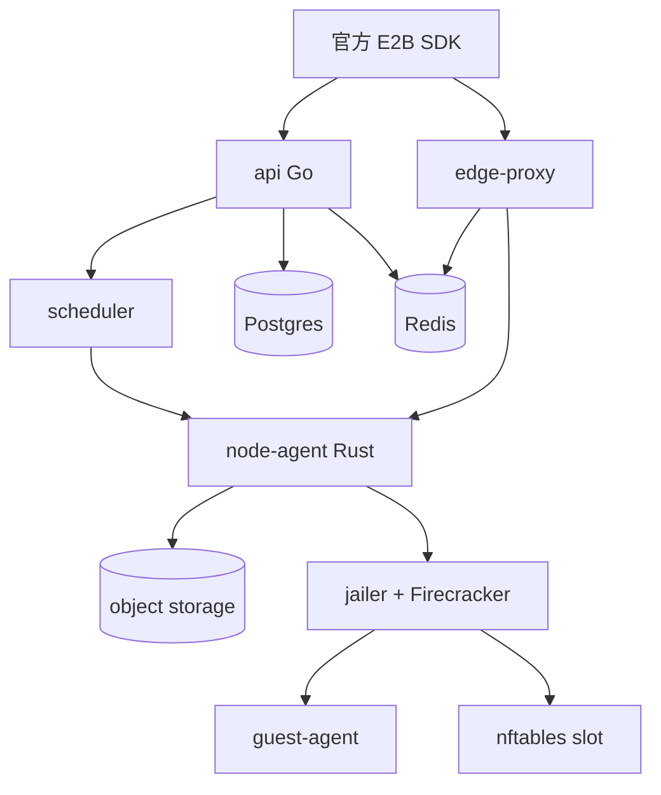
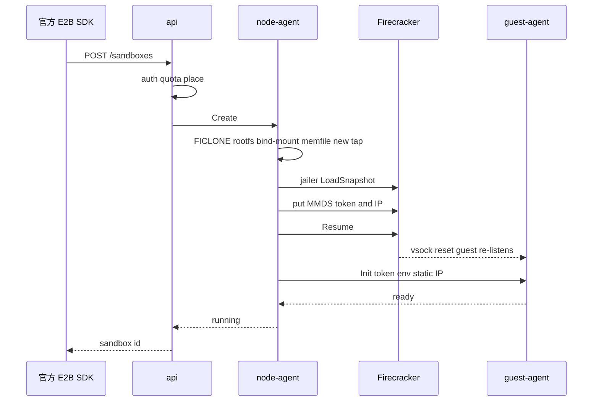

# 从零自研 MicroVM 沙箱云：商业化开发方案

日期：2026-10-27。产品全自研，公开线协议兼容官方 E2B SDK。不调用 api.e2b.app，不把 E2B、CubeSandbox、Modal、Daytona、阿里云或火山的服务端链进运行时。官方 SDK 只出现在契约测试里，作为客户。

## 0. 边界

自研的是沙箱云，不是虚拟机监视器。

| 层 | 谁写 | 原因 |
| --- | --- | --- |
| KVM | Linux 上游 | 硬件虚拟化不是产品 |
| VMM | Firecracker 上游，版本钉死，不分叉 | 设备模型、jailer、seccomp、快照格式已经有生产用户。自写 VMM 是另一家公司，18 个月后仍然比 Firecracker 不安全 |
| 客户机内核 | 上游 Linux，我们只维护 config 和启动参数 | 分叉内核是永久税 |
| 节点监督、快照编排、磁盘 COW、网络槽位、UFFD 处理、客户机代理、模板构建 | 我们写 | 这是产品 |
| API、调度、计量、鉴权、边缘代理、审计 | 我们写 | 这是云 |
| Postgres、Redis、对象存储、裸金属 | 买 | 不要自建数据库 |

运行时不调用任何沙箱厂商。公开线协议按官方 E2B SDK 实现，客户不用装我们的 SDK。

| 允许 | 形式 | 不允许 |
| --- | --- | --- |
| Firecracker + jailer | 钉死版本的本地二进制，节点经 Unix 套接字驱动 | 调用 E2B、Cube、Modal、Daytona、阿里云、火山的沙箱 API 或引入它们的 SDK |
| Linux KVM、客户机内核 | 上游，我们维护 config | 把厂商节点代理、shim、控制面当库链接进来 |
| Postgres、Redis、对象存储 | 我们部署、我们持有数据 | 用厂商控制台创建沙箱，再在外面包一层 |
| 官方 E2B SDK | 只在 CI 里当客户。`E2B_API_URL` 指向我们 | 服务端 import 它，或由它去调用 E2B 的云 |

Firecracker 官方快照文档（2026-10-27 读取）决定了数据面形状，不是我们的偏好：

- 快照是三份用户负责的文件：内存文件、vmstate、磁盘。磁盘 Firecracker 不管。
- `LoadSnapshot` 对内存文件做 `MAP_PRIVATE`。未触及的页按需加载，写入变成匿名写时复制。同一份只读内存文件可以被多台 microVM 共享。同节点快速创建不需要自己写 userfaultfd。
- 内存文件必须活过这台 VM 的整个生命周期。删模板文件等于杀掉所有从它恢复的沙箱。
- 全量快照会把客户机内存全部触页并写盘。Diff 快照仍是 developer preview，且一般不能单独恢复，要按顺序 rebase 到 base。商业暂停不能押在 Diff 上，直到我们自己的 spike 通过。
- 快照文件被 Firecracker 信任。vmstate 只有 64-bit CRC，不含内存和磁盘。跨信任边界必须由我们做认证和加密。
- 恢复后网络连接不保留，vsock 已有连接被重置，监听套接字还在。MMDS 的数据存储不进快照。
- cgroup v1 上恢复很慢。宿主只用 cgroup v2。
- 启动早期打的快照会在恢复时崩溃。模板快照必须在客户机代理就绪之后打。
- 不使用 CPU template 时，快照不能在不同微架构之间恢复。模板格式从第一天就记录 CPU template，即使 v1 还不跨节点。

自写 VMM、自写 TLS 栈、自写 eBPF 虚拟交换机，都不在 v1。这三件事各自是一个研究项目。

## 1. 商业化的定义

可签约的单区域公有云，不是演示，也不是 SOC 2 完成态。

必须同时为真：

1. 一个信任域一台 microVM，独立内核。钉死版本的官方 E2B SDK 只改 `E2B_API_URL` 和 `E2B_API_KEY`，能创建、跑命令、传文件、销毁。
2. 两个租户互不可列、不可连、读不到对方的快照对象。
3. 计量可对账：账单来自不可变用量事件，和节点心跳的偏差有夜间作业，偏差超过 0.1% 告警。
4. 节点进程崩溃或磁盘满时，该节点上的沙箱失败关闭，其他节点不受影响。不假装热迁移。
5. 云元数据地址从沙箱内不可达，有回归测试。
6. 密钥明文不进客户机、不进日志、不进快照。
7. 有值班、状态页、速率限制、审计、密钥轮换、控制面备份。
8. 外部渗透测试过一次，高危关闭后才对公网开付费。

明确不是 v1：GPU、Windows、沙箱内 KVM、热迁移、跨节点透明恢复、30 秒自动睡眠、浏览器串流、SOC 2 报告、E2B OpenAPI 全量端点。

定价结构沿用已核对的 E2B 形状，不在这里重算：Running 按预留 vCPU/内存墙钟计，Paused 和 Dead 不计计算，冷快照超额按 GiB-月。套餐买并发和会话时长。人民币锚在 E2B 公开价的大约 70–90%，签价前重核裸金属成本。

## 2. 我们要交付的系统



沙箱流量不经过 api。api 只发生命周期命令。

### 2.1 仓库

一个仓库，四个可独立发布的二进制。不按「未来可能的微服务」拆库。

```
cmd/api            控制面
cmd/edge           边缘代理
cmd/node-agent     节点监督，Rust
cmd/guest-agent    客户机内代理，静态链接
cmd/template-build 构建机
internal/fc        Firecracker HTTP API 客户端
internal/cow       FICLONE、快照清单
internal/slots     tap / nftables
internal/meter     用量事件
compat/            钉死版本的官方 E2B SDK 契约测试，发布门
```

语言：节点侧 Rust。控制面和边缘 Go。客户机代理 Rust，静态链接，不依赖客户机 glibc。不要全栈一种语言硬凑。节点代码以 root 邻接不可信 VM，用 Rust。控制面是 HTTP、Postgres、配额，用 Go，招人快。

Firecracker、jailer、客户机内核以校验过的版本随节点镜像发布，不在运行时从网上下。

### 2.2 创建路径

这是整个产品的热路径。别的功能都绕它建。



同节点创建不做内存拷贝。模板内存文件只读，bind-mount 进每个 jail，Firecracker `MAP_PRIVATE` 共享干净页。磁盘是 XFS 上对模板 raw ext4 的 `FICLONE`。热路径上禁止：复制内存文件、从对象存储拉全量、启动客户机内核、运行 DHCP。

就绪的定义不是 Firecracker 进程起来，而是 guest-agent 对 `Init` 回答 ready。超时则杀进程、删 jail、把槽位还回池，API 返回 503，计量不开始。

### 2.3 快照格式

版本化，写进 `manifest.json`。不兼容就升 major，不在加载时猜测。

| 字段 | 内容 |
| --- | --- |
| `format` | `1` |
| `fc_version` | 打快照的 Firecracker 版本。加载端主版本必须一致 |
| `kernel_version` | 客户机内核。恢复不换内核 |
| `cpu_template` | Firecracker CPU template 名。宿主必须匹配 |
| `arch` | `x86_64`。arm64 是另一条模板线 |
| `vcpu` `mem_mib` | 规格。v1 不热改 |
| `vmstate_sha256` | vmstate |
| `mem_sha256` | 内存文件。模板是 base；用户暂停若走 Diff，另记 `parent` 和层哈希 |
| `rootfs_sha256` | raw ext4 |
| `guest_agent_version` | 代理版本。控制面按这个开功能 |

模板和用户暂停用同一格式。模板的内存文件是 base，只读，引用计数。用户暂停的磁盘是暂停时刻的 FICLONE，不是运行中文件的别名。

完整性：清单哈希由节点在发布前计算，控制面保存。加载前校验。Firecracker 的 CRC 不算我们的完整性。对象存储上的冷副本用租户密钥加密。密钥不进客户机。

模板删除：引用计数到零才删文件。有 Running 或 Paused 引用时拒绝删。

### 2.4 暂停

三条路径，按顺序做，不并行发明。

| 路径 | 何时 | 行为 |
| --- | --- | --- |
| 超时销毁 | v1 默认 | 杀 VM，删除本机 jail。无状态解释器的正确语义 |
| 全量暂停 | M3，显式 API | guest-agent `Freeze` → Firecracker `Pause` → `CreateSnapshot Full` → FICLONE 磁盘 → 上传或留本机 → 杀进程。延迟随内存线性增长。文档写明，限流 |
| Diff 暂停 | 仅 spike 通过后 | `track_dirty_pages` + `Diff` + 以后 rebase。官方仍标 developer preview。spike 失败就保持全量暂停，不做 auto-pause |

自动暂停的开工条件：在我们的机器上，2 GiB 沙箱 pause p95 < 200 ms，且写盘量接近脏页而不是客户机内存。没达到，产品就是超时销毁加显式全量暂停。

计费在状态进入 `paused` 且清单哈希落盘之后停。暂停失败保持 `running`，继续计。

### 2.5 网络

v1 用槽位池，不用 eBPF。

节点启动时预建 N 个 tap（先 256）。每个槽位：一个 tap、一个点对点 IP、nftables 里的一个句柄。创建只是从池里取，不在热路径 `ip tuntap add`。

每个沙箱：

- 独立 MAC。克隆不能沿用模板 MAC。Firecracker 有专门的 clone 网络说明，恢复不保留连接。
- 静态 IP 由 `Init` 经 vsock 推进客户机。不跑 DHCP。
- 沙箱之间默认不通。
- 默认丢弃 `169.254.169.254/32`、`169.254.0.0/16`、宿主管理网段、节点之间的控制网。
- 出站公网：开发项目默认允许；生产项目默认拒绝，允许列表是 CIDR 和之后的域名。v1 域名可以只做到 SNI 窥视，不做 MITM。
- 用户端口经 edge-proxy 转到槽位 IP。控制通道不在这条路上。

eBPF 的触发条件：单节点稳定超过 400 个槽位，且 nftables 更新出现在创建 p99 里。在那之前写 eBPF 是范围蔓延。

### 2.6 客户机代理

控制通道对 SDK 必须是 envd 线协议。官方 SDK 创建成功后，用返回体里的 `domain`、`envdAccessToken`、`trafficAccessToken` 直接访问沙箱主机上的 envd，并用 `E2b-Sandbox-Id` 与 `E2b-Sandbox-Port` 指定目标。只实现控制面 REST、执行却走私有协议，SDK 的 `commands.run` 和文件 API 会失败。

节点和客户机之间仍可用 vsock 做 SDK 看不到的事：下发静态 IP、暂停前 `Freeze`。执行和文件的公开面是 envd。

- 公开监听 envd 的进程与文件系统子集。边缘把 `E2b-Sandbox-Id` / `E2b-Sandbox-Port` 转到这台沙箱，不把控制用的 vsock 暴露出去。
- 恢复后重新监听。每次恢复由节点重新下发 `envdAccessToken` 和静态 IP。MMDS 数据不进快照。
- 文件路径必须落在工作根之内，拒绝符号链接逃出。
- vsock 只做 `Freeze` / `Thaw` 和网络初始化。SDK 不走这条通道。
- 不提供任意宿主机调用，不在模板里放 SSH。

VMGenID 打开。代理看到 generation 变化就重新取初始化，并重新生成会泄漏克隆身份的状态。

### 2.6.1 兼容范围

契约是某两个钉死版本的官方 Python SDK 和 JS SDK，不是 `e2b-dev/infra` 当天的整份 OpenAPI。M2 开始时把版本写进 `compat/versions.txt`，用这些版本抓一份创建、执行、读文件、销毁的请求记录。实现跟这份记录走。SDK 升级是一次兼容发布，不是自动跟着上游。

创建响应必须带上 SDK 要的字段：`sandboxID`、`templateID`、`clientID`、`envdVersion`，以及 `envdAccessToken`、`trafficAccessToken`、`domain`。鉴权头用 SDK 实际发送的那个（当前是 `X-API-Key`）。错误体是 `{code, message}`，429 带 `Retry-After`。键的前缀若被钉死的 SDK 在客户端校验，我们发它要的前缀；这不表示我们在调用 E2B。

| 能力 | v1 | 未实现时 |
| --- | --- | --- |
| `POST /v2/sandboxes`，若记录里仍有 `POST /sandboxes` 则两个都做 | 做 | |
| `GET/DELETE /sandboxes/{id}`，`POST .../timeout`，`POST .../connect` | 做 | |
| envd 进程启动、stdout/stderr 流、信号、PTY | 做 | |
| envd 文件上传、下载、列目录 | 做 | |
| `allow_internet_access`、`envVars`、`metadata`、`timeout` | 做 | |
| `e2b-code-interpreter` 的 `run_code` | 做，单独钉版本。它还会打代码解释端口，不只 envd | |
| `pause` / `resume` / `fork` / snapshots | M3 | 501，错误体仍是 E2B 形状。不静默忽略 |
| `autoPause: true` | M3 之前拒绝 | 400。默认值是 false，普通 `create` 不受影响 |
| volumes、secrets、webhooks、template build CLI、admin | 不做 | 501 |

`secure` 字段按他们的规格忽略，通信一律走令牌。

### 2.7 模板构建

构建机和运行机分开。构建机能跑不可信 Dockerfile，所以它自己也是一台沙箱宿主机，只是不进客户调度池。

步骤：

1. 拉 OCI，解到新的 raw ext4。大小在构建请求里给定，v1 固定几档：4 / 10 / 20 GiB。
2. 把 guest-agent 和 systemd unit 放进镜像。客户不负责装代理。
3. 用与运行节点相同的内核、Firecracker 版本、CPU template 启动。
4. 等代理 ready，跑构建脚本（`pip install`、`apt`）。
5. `Freeze`，全量快照，算清单哈希，发布到本区域的模板库。
6. 运行节点按需把内存文件和 rootfs 拉到本地 XFS。热模板预热到所有运行节点。

升级 Firecracker 或客户机内核 = 重打全部模板。这是运维程序，不是意外。控制面拒绝把旧 `fc_version` 的快照调度到新二进制上。

### 2.8 控制面

Go，一个 api 进程。调度是它里面的一个包，直到放置逻辑需要独立扩容再拆。不要第一天拆成七个服务。

Postgres 是租户和账单的真相。Redis 是运行态租约，丢了可以靠节点重报重建，不能靠它出账单。

表，v1 就这些：

| 表 | 作用 |
| --- | --- |
| `tenants` | 组织、套餐、并发上限、出站策略、是否封锁 |
| `api_keys` | 只存哈希。前缀可显示 |
| `templates` | 清单位置、哈希、fc/kernel/cpu template、规格 |
| `sandboxes` | 期望状态、节点、规格、模板、超时 |
| `snapshots` | 用户暂停或 fork 的清单。`parent_id`，引用计数 |
| `usage_events` | 不可变。`sandbox_id`，`from`，`to`，`vcpu`，`mem_mib`，`reason` |
| `audit_log` | 谁创建、谁删、出站拒绝。不含环境变量和文件内容 |
| `nodes` | 心跳、容量、排水、fc 版本、CPU template |

放置：过滤健康、未排水、版本匹配、已承诺内存加本次规格不超过天花板的节点。优先热模板已在本地的节点。在剩余里抽 K 个，分数取 CPU 利用率和内存承诺比的较大者。节点可以拒绝，api 抖动退避。全部拒绝返回容量错误。

准入按承诺内存，不按 RSS。`MAP_PRIVATE` 的干净页看起来几乎不占驻留，Agent 同时恢复会一起触页。

运行态记录在 Redis，带租约。节点每 5 秒续租。租约过期，api 把沙箱标 `lost`，停表，不把它算成还在跑。

删除租户：封锁、吊销 key、杀 Running、保留用量事件。可重入。

### 2.9 边缘

`https://<port>-<sandboxID>.<domain>` 解析出端口和 ID，查 Redis 得节点和槽位，反代到节点上的本地代理，再进 tap。访问令牌放在每个沙箱的 header 或签名 URL 里。令牌和 API key 不是同一个。

暂停的沙箱 v1 不在边缘自动恢复，除非 M3 的显式暂停已经上线。上线之后，同一沙箱的并发未命中合并成一次 resume。不合并的话，一个页面会打出 N 次恢复。

### 2.10 计量

状态边沿写 `usage_events`。只追加。账单是这些区间的和，不是 Redis 里某个计数器。

夜间作业：用节点上报的 cgroup 存活区间对账。偏差超过 0.1% 告警，不自动改账单。人工修要另写一行补偿事件。

v1 账单可以是每月 CSV 加人工开票。商业化要求的是数能对上，不是一个计费微服务。支付用现成服务，不自写支付。

## 3. 安全程序

和功能同一条发布门，不另排「以后加固」。

每个 Firecracker 进程经 jailer：独立 cgroup、chroot、seccomp、丢权限。禁止把宿主目录 bind-mount 进客户机。模板内存文件以只读挂进 jail。

隔离回归，合入主分支必跑：

- 沙箱内访问 `169.254.169.254` 失败
- 沙箱内访问另一个沙箱的 IP 失败
- 沙箱内读不到宿主文件系统
- 文件 API 用符号链接指向 `/etc/passwd` 或 jail 外失败
- 租户 A 的 key 不能 `GET` 租户 B 的沙箱、快照、模板
- 快照对象用租户 B 的凭据读失败
- 恢复后的克隆 MAC、IP、VMGenID 与模板不同
- 日志和审计样本里没有测试密钥

发布前一次外部渗透。高危未关，不对公网收款。

密钥：v1 不把密钥放进客户机。需要出站认证的生产客户，等到 L7 代理（M4）再卖这个能力。v1 的诚实说法是「出站允许列表，密钥你自己放，我们不替你保管」。不要在 MITM 写完之前承诺 credential vault。

## 4. 里程碑

六个人，都写过生产系统。缺一个写过 KVM、cgroup 或 Firecracker 的数据面负责人，下面的周数乘二。这不是缓冲，是关键路径。

| 里程碑 | 周 | 交付 | 退出条件 |
| --- | --- | --- | --- |
| M0 单机生命周期 | 1–4 | jailer 启动 Firecracker，vsock 执行一条命令，杀掉并回收槽位 | 隔离回归前四条过。创建失败不留 tap 和进程 |
| M1 快照创建 | 5–10 | 模板快照、FICLONE 磁盘、共享内存文件恢复、guest-agent Exec/Files | 同节点创建 p95 我们自己测。就绪=代理 ready。克隆 IP/MAC 不同 |
| M2 云的最小闭环 | 11–16 | api、envd 子集、两节点、鉴权、配额、边缘、用量事件、一个代码模板 | 钉死的官方 SDK 只改 URL 和 key，通过创建、执行、文件、销毁。杀一个节点，另一个节点的沙箱还在，被杀节点的沙箱 `lost` 且停表 |
| M3 可签约 | 17–24 | 显式全量暂停、审计、速率限制、控制台用量、状态页、值班、渗透测试 | 第 1 节八条全真。Diff 暂停只作为 spike 报告，不作为功能 |
| M4 企业档 | 25–40 | UFFD 跨节点懒加载、L7 密钥注入、私有化安装包、SOC 2 证据 | 排水时已暂停沙箱在另一节点恢复。未暂停的不假装能迁 |

### M0 周计划

第 1 周：钉 Firecracker 版本和 CPU template。cgroup v2 裸金属。jailer 拉起一个直接启动的内核，串口看到用户态。不写 API。

第 2 周：vsock 上的最小代理，执行 `echo`。宿主侧 Rust 客户端。进程树和 cgroup 回收测 1000 次。

第 3 周：tap 槽位池，静态 IP，nftables 丢弃元数据网段。隔离测试进 CI。

第 4 周：失败注入。代理不回答、磁盘满、Firecracker 退出。每种都要回到零进程、零 tap。没有这个，后面的快照会在脏状态下调试。

### M1 周计划

第 5–6 周：raw ext4 构建，直接启动，等代理，打全量快照，从快照恢复同一台。确认 Firecracker `MAP_PRIVATE` 在我们的版本上共享干净页：起 50 台空闲，比 RSS 和承诺内存。这个数写进容量模型，不引用 Cube 的 25 MB。

第 7 周：FICLONE 磁盘。两台沙箱写同一文件的不同内容，互不可见。暂停 VM 后再 FICLONE，哈希稳定。

第 8 周：克隆身份。新 MAC、新 IP、VMGenID、重新 `Init`。vsock 在恢复后重连。这是 Firecracker 文档里的硬约束，不是体验优化。

第 9 周：文件 API 和 PTY。符号链接测试。

第 10 周：OCI 到模板的一条管道。一个 Python 模板。内部能用 CLI 创建并跑一段代码。仍然没有多租户。

### M2 周计划

第 11–12 周：Postgres 表、API key 哈希、`POST /sandboxes`、`DELETE`。节点 gRPC：`Create` `Delete` `List`。

第 13 周：两节点放置、Redis 租约、心跳、`lost`。

第 14 周：边缘代理和访问令牌。公网只开 api 和通配域名。

第 15 周：用量事件和每日对账作业。故意制造 1% 偏差，确认告警。

第 16 周：官方 E2B SDK 契约测试进 CI。先抓这份 SDK 的真实请求，再补实现。不按当天的整份 OpenAPI 猜。

### M3

全量暂停和恢复，限流。审计。控制台只做三页：沙箱列表、用量、API key。状态页。运行手册：节点排水、模板重打、密钥泄漏、磁盘满。外部渗透。然后才开放付费。

Diff / auto-pause 在 M3 用两周 spike。失败就写进决策记录，不延期 M3 去修。

### M4

UFFD 处理进程按 Firecracker 文档写：处理器、UDS、内存文件都在 jail 内；处理进程崩溃会导致 Firecracker 在缺页时永久等待，所以节点监督必须盯着它，超时则杀 VM。页来自本地缺失时向对象存储或持有该页的节点取。这是跨节点的唯一路径。整份拷贝内存文件只作为排水的慢路径，不作为产品 SLO。

L7 出口代理用语言自己的 TLS 栈做 MITM，不自研密码学。客户机信任我们签发的根，根烧进模板。密钥在代理上按允许的主机注入。

## 5. 人员和值班

| 角色 | 人数 | 从哪一周在 | 负责 |
| --- | --- | --- | --- |
| 数据面 | 2 | 第 1 周 | jailer、快照、磁盘、槽位。其中一人必须交付过 KVM 或 Firecracker |
| 客户机与模板 | 1 | 第 2 周 | 内核 config、代理、OCI 构建 |
| 控制面 | 2 | 第 8 周进，之前可一人 | api、调度、计量、边缘 |
| SRE / 安全 | 1 | 第 12 周 | CI 隔离测试、渗透协调、值班、节点镜像 |

六人以下能做 M0–M1。把 M3 叫商业化，至少要这六人。控制台可以外借一个前端，不占数据面名额。

值班从 M2 有设计伙伴开始。两班就够。页面：创建 p95、节点失联、对账偏差、磁盘、槽位耗尽。没有这四条，不要接付费。

## 6. 测试和发布

| 层 | 测什么 | 不测什么 |
| --- | --- | --- |
| 单元 | 放置分数、配额、路径清洗、清单哈希 | Firecracker 会不会启动 |
| 集成 | 真机：创建、恢复、克隆身份、回收 | mock 掉节点后断言调用了 Create |
| 隔离 | 第 3 节清单 | 端口开着 |
| 契约 | 钉死版本的官方 E2B SDK 对真实 api 和 envd | 我们自己的客户端能调我们自己的私有协议 |
| 浸泡 | 24 小时创建/销毁，槽位和进程回到基线 | 跑过一次就算 |
| 混沌 | 杀 node-agent、杀 Firecracker、写满数据盘、代理挂起 | 杀完能手动重启就算过 |

发布：节点镜像和 api 分开升。快照格式 major 不匹配就拒绝调度，不在线迁移格式。模板重打是发布步骤的一部分。

生产宿主：内存优化裸金属，cgroup v2，XFS，NVMe，嵌套虚拟化打开只为了构建机实验。普通云主机没有 `/dev/kvm` 不能进池。

## 7. 运维程序，和功能一起写

节点排水：标记不可调度，等 Running 结束或超时，Paused 留在本机直到 M4。不在 M3 承诺迁走。

磁盘水位：数据盘超过 80% 停止创建。模板缓存按引用和热度驱逐，被 Running 引用的内存文件不许驱逐。

Firecracker CVE：钉版本，镜像重建，滚动节点。不在运行中的节点上热补 VMM。

控制面：Postgres 每日备份，恢复演练在 M3 做一次。Redis 可丢。

泄漏的 API key：吊销是一行更新加缓存失效。不要求客户重装任何东西。

## 8. 不做

- 自写 VMM、BIOS、设备模拟
- 分叉 Firecracker 来加一个设备。缺设备就换产品范围，不换 VMM
- 把任何沙箱厂商的 SDK、控制面或节点代理链进运行时。缺客户库就写我们自己的薄客户端
- 用 Diff 快照做默认暂停，在 spike 报告出来之前
- 用 RSS 当容量
- 把 Cube 的 48 ms 或 E2B 的价格页写成我们的 SLO
- 第一天多区域。单区域做对，再复制节点池和模板库

## 9. 决策记录

1. VMM 用上游 Firecracker，不包装 Cube，不分叉 Cloud Hypervisor。Cube 的 reflink 和出口代理是想法，不是代码依赖。磁盘 COW 我们用 XFS `FICLONE`，因为 Firecracker 只吃 raw 盘，而且磁盘本来就要我们自己管。
2. 同节点热路径用官方 `MAP_PRIVATE` 共享模板内存文件。UFFD 只为跨节点懒加载而写，放在 M4。
3. 公开协议是钉死版本的 E2B 控制面加 envd。vsock 只留给出站 SDK 看不到的宿主操作。不实现 OpenAPI 全量端点。
4. v1 商业语义是超时销毁。显式暂停是全量快照，限流，写进合同。auto-pause 有数字门槛。
5. 控制面、边缘、客户机代理全部自写。公开契约由官方 E2B SDK 验收，不自写第二套客户库作为发布门。Postgres、Redis、对象存储是我们运维的基础组件。Firecracker 是钉死版本的本地 VMM 二进制，经 Unix 套接字驱动，没有厂商账号，也没有云 API。
6. 六人、约 24 周到可签约单区域。数据面负责人不到位，不对外承诺日期。

## 10. 来源

- Firecracker 快照：https://github.com/firecracker-microvm/firecracker/blob/main/docs/snapshotting/snapshot-support.md
- Firecracker userfaultfd：https://github.com/firecracker-microvm/firecracker/blob/main/docs/snapshotting/handling-page-faults-on-snapshot-resume.md
- 竞品事实和价格：`docs/microvm-sandbox-plan.md`
