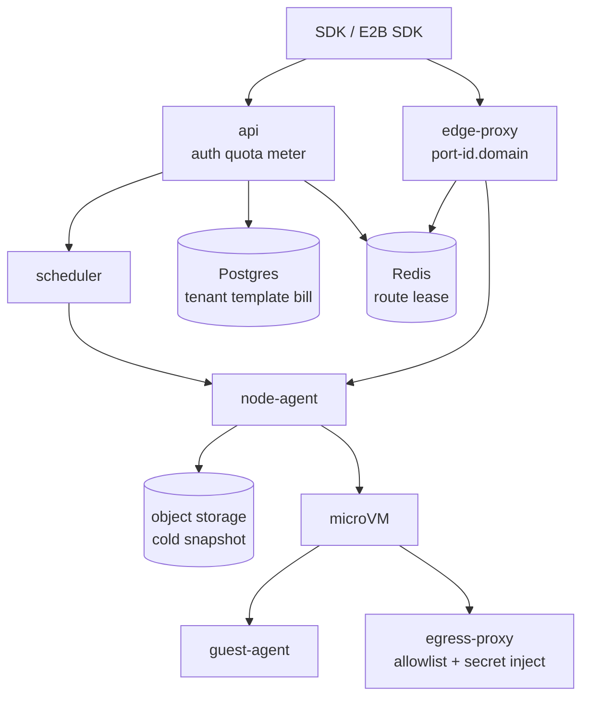
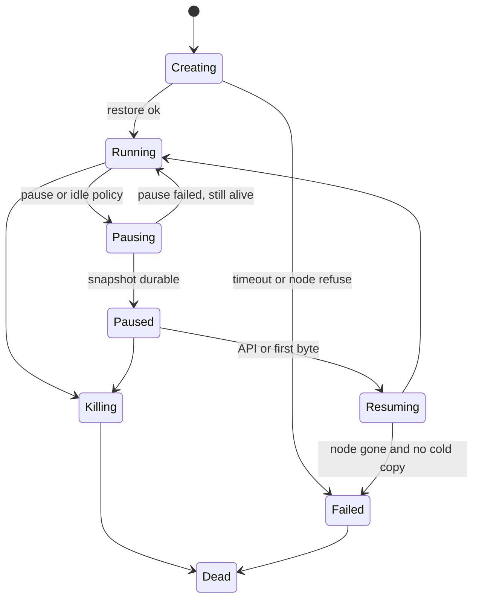

# MicroVM 沙箱云服务方案

日期：2026-10-27。事实来自 E2B、CubeSandbox、Firecracker、Modal、Fly.io 的一手文档和仓库；未读到的实现细节标为推断。

> 构建路径已改。包装 CubeSandbox 不再是选定方案。从零自研的商业化开发计划见 [from-scratch-build-plan.md](from-scratch-build-plan.md)。本文保留竞品事实和单位经济，不作为实施规格。

## 0. 决策

做「一个信任域一台 microVM」的多租户云，公开契约兼容 E2B SDK 子集。创建的语义是恢复预启动快照，不是冷启动操作系统。

90 天内不要从零写 VMM，也不要 fork `e2b-dev/infra` 当产品。控制面自建。数据面第一阶段部署 [CubeSandbox](https://github.com/TencentCloud/CubeSandbox)（Apache-2.0，E2B API 兼容，腾讯云生产验证过）。必须自有的是：租户隔离、计费、配额、密钥不出沙箱、以及「暂停路径是否撑得起 auto-pause」的实测门槛。

楔子不是「我们也有 microVM」。国内已经有腾讯 CubeSandbox、阿里云函数计算云沙箱和 ACS Agent Sandbox。能卖的是：数据驻留 / 私有化、E2B URL 替换即可迁入、默认拒绝元数据网段、密钥在出口注入。不跟 Modal 拼 GPU，不跟 Fly 拼全球边缘。

三个前提，错一个方案就翻：

1. 第一批客户要国内或私有化，不是去美国正面打 E2B。
2. 负载是 CPU 代码执行和 coding agent，不是 GPU rollout。
3. 能拿到裸金属或打开嵌套虚拟化的专属宿主机。没有 KVM，这个产品不存在。

## 1. 它到底是什么

最小粒子不是容器，也不是一台一直开着的虚拟机。是一份可恢复的客户机快照（内存 + 磁盘 + 设备状态），加上宿主上的一个网络槽位和一段可计费的 Running 租约。

产品做的状态转换：不可信代码 → 在独立内核里恢复快照 → 按网络策略放行 → 对 Running 区间记账 → 暂停或销毁后计算归零。

它不是：

| 邻近物 | 差在哪 |
| --- | --- |
| Docker / 共享内核容器 | 逃逸面是宿主内核。LLM 生成的代码无法做镜像审计。 |
| gVisor | 拦截 syscall，不是独立内核。适合低风险、要密度的一档，不能当默认信任边界。 |
| 传统云主机 | 隔离够，启动是秒到分钟，密度和暂停经济不成立。 |
| Cloudflare Workers isolate | 不是 Linux。跑不了任意二进制、apt、浏览器。 |
| E2B 云本身 | 是竞品，不是组件。自建是为了驻留、私有化和出口策略，不是为了再做一个控制台。 |

## 2. 为什么是现在这个形态

旧矛盾：Agent 要一个完整 Linux 来跑它刚写的代码，而这段代码不可审计。共享内核太松，传统 VM 太慢。

2018 年 AWS 用 Firecracker 把「独立内核」压到约 125 ms、每 VM 数 MiB 的 VMM 开销，服务 Lambda / Fargate。2024–2026 年 Agent 把「每次会话一台电脑」变成默认 API。E2B 把这件事产品化成：创建 = 恢复预启动快照，内存用 userfaultfd 按页加载，根文件系统写时复制。CubeSandbox 走另一条：RustVMM / Cloud Hypervisor 定制 + XFS reflink，同节点克隆是元数据操作。

利益结构：客户买的是「安全团队能签字的隔离」和「等模型时不要按小时烧钱」。平台赚的是 Running 秒数和并发席位，不是快照存储本身——存储若不计价，脏页会吃掉毛利。

## 3. 竞品：抄结构，不抄口号

### 3.1 两套参考架构

**E2B**（[架构文档](https://github.com/e2b-dev/infra/blob/main/docs/ARCHITECTURE.md)，仓库 Apache-2.0，2026-10-27 仍在更新）

- 每沙箱一个 Firecracker 进程，独立内核。jailer + cgroup + seccomp。
- 模板是预启动快照：`memfile` + `rootfs.ext4` + `snapfile`。创建是恢复，不是 boot。
- 内存：userfaultfd 懒加载，只取被碰到的页。根文件系统：只读模板 + 用户态 NBD 的 COW 层，暂停时导出脏块。
- 控制面决定跑在哪（Postgres 持久，Redis 运行态）。节点上的 orchestrator 决定怎么跑。沙箱流量不经过 API。
- 边缘：`https://<port>-<sandboxID>.<domain>` → client-proxy → 节点 :5007 → 客户机。暂停的沙箱在流量到达时由 API `ResumeSandbox` 拉起，同进程合并并发 resume。
- 客户机里的 `envd`（:49983）提供进程、PTY、文件系统。控制路由不从公网进。
- 网络：预分配 netns + veth + tap + nftables。每槽位出站防火墙，可按 SNI/Host 做域名允许/拒绝。
- 调度：best-of-K，按 CPU 与 hugepage 池负载取较差者。节点可 `ResourceExhausted` 拒绝，调用方抖动退避。
- 密钥：API 只存标记。解析发生在沙箱出口，不把明文送进客户机。
- 公开价（[pricing](https://e2b.dev/pricing)，2026-10-27 读取）：$0.000014/vCPU-秒（$0.0504/vCPU-时）+ $0.0000045/GiB-秒（$0.0162/GiB-时）。只在 Running 计费。Hobby $0、一次性 $100、20 并发、单次最长 1 小时。Pro $150/月买 100 并发和 24 小时会话，计算另计。无 GPU。规格 1–8 vCPU、1–8 GiB。

**CubeSandbox**（[架构](https://docs.cubesandbox.com/architecture/overview)、[介绍](https://docs.cubesandbox.com/guide/introduction)，Apache-2.0，2026-10-27 约 13k star）

- CubeAPI（Rust，宣称 E2B 兼容，换 `E2B_API_URL`）→ CubeMaster（Go 调度）→ Cubelet（节点生命周期）→ CubeShim（containerd shim v2）→ CubeHypervisor（Cloud Hypervisor 定制，RustVMM + KVM）。
- CubeCoW：XFS `FICLONE`，快照/克隆是 O(1) 元数据。增量脏页用 soft-dirty。
- CubeVS：eBPF 做 SNAT/DNAT 和策略，不用每沙箱一条 iptables。
- CubeEgress：TPROXY + L7 MITM。域名允许列表，把 `Authorization` 注在出口，密钥不进沙箱。
- 控制面状态在 Redis。持久多租户、账单、审计比 E2B 薄。
- 本地部署文档允许任意非空 API key。这是单机模式，不能当云的认证。

Cube 自己的裸金属基准（腾讯云 BMI5，96 逻辑核，375 GiB，2 vCPU / 2 GiB，[2026-06-01](https://docs.cubesandbox.com/blog/posts/2026-06-01-cubesandbox-perf-benchmark)）。这些数字依赖那台机器和那个镜像，不能写成 SLA：

| 操作 | 实测 |
| --- | --- |
| 从模板串行创建 | avg 47.8 ms，p95 57.4 ms |
| 20 并发创建 | avg 98.1 ms，p95 175.8 ms，吞吐 180.9/s |
| 50 并发创建 | avg 276 ms，p95 508 ms |
| 空闲密度 | 1000 台约 25.7 MB/台，不是营销说的 <5 MB |
| 写满 2 GiB 时的容量估算 | 约 185 台/宿主，不是数千 |
| 增量快照，脏页 7 MB | avg 45.7 ms |
| 增量快照，脏页 1.1 GB | avg 486.9 ms |
| 从快照再创建 | 60–85 ms，与脏页大小无关（同节点 CoW） |
| 单次 clone | avg 220 ms |
| 单次 rollback | avg 81.6 ms |
| Pause（当前全量拷贝） | 串行 avg 558 ms / 2 GiB |
| Resume | 串行 avg 41.8 ms |

营销句「<60 ms、<5 MB、数千台」里，只有同节点串行创建的 p95 被这份基准撑住。<5 MB 是 VMM 开销口径，不是驻留集。Pause 仍是全量内存拷贝；soft-dirty pause 是预期，不是已交付。跨节点 S3 恢复在文档里是 preview。

### 3.2 其余玩家

价格摘自 Fly.io 2026-09-09 的对照（其文注明 2026-10-05 复核各家定价页）。用于量级，签合同前重读原页。

| 产品 | 隔离 | 启动语义 | 计费形状 | 不跟它拼的点 |
| --- | --- | --- | --- | --- |
| E2B | Firecracker | 快照恢复 + UFFD | 预留资源墙钟，暂停不计 | 美国 SaaS、无 GPU |
| CubeSandbox | Cloud Hypervisor 定制 | 同节点 reflink 恢复 | 自托管，无云计费 | 它是运行时，不是我们要做的云 |
| Modal | 默认 gVisor，另有 VM Sandbox | 函数/沙箱 | 物理核，Sandbox 比函数贵 | GPU 和大规模函数 |
| Daytona | 容器 + microVM pause/fork | 快照、GPU、Windows | 与 E2B 同价量级 | 2026-06 核心开发转入私有仓库 |
| Vercel Sandbox | Firecracker（Hive） | 默认可持久化文件系统 | Active CPU + 预留内存 | 绑在 Vercel 部署体系 |
| Cloudflare Sandbox | Firecracker 里再跑容器 | Durable Object 协调 | Active CPU + 固定规格 | 边缘集成，冷启动常 1–3 s |
| Fly Sprites | Firecracker + 客户机内编排 | 池化空机，1–2 s 创建；热唤醒 100–500 ms | 按实际 CPU/内存，约 30 s 空闲后只收存储 | 持久化电脑，对象存储根盘 |
| microsandbox | libkrun | 本地优先 | 库，不是云 | 开发机运行时 |
| 阿里云 FC 云沙箱 / ACS Agent Sandbox | 文档称云沙箱；ACS 写明 MicroVM 级 | 按需创建、用完释放 | 云厂商计费 | 已是渠道里的默认选项 |
| 火山引擎 veFaaS | 未核到 microVM 实现细节 | Serverless | 未作为事实引用 | 不要在没读实现时写成同类 |

[Modal VM Sandboxes](https://modal.com/docs/guide/vm-sandboxes) 确认：默认可走 gVisor，也可以跑在完整虚拟机上。GPU 把 Modal、Northflank、Daytona 和纯 CPU 沙箱分开。Firecracker 没有可用的 GPU 直通产品路径。

### 3.3 隔离技术，只留一个生产 VMM

| 技术 | 边界 | 适合 | 不适合 |
| --- | --- | --- | --- |
| Firecracker | KVM + 极小设备模型（virtio-net/block/vsock） | 不可信代码的默认边界。快照 + userfaultfd 是跨节点懒加载的成熟路径 | virtio-fs、GPU、Windows、嵌套 KVM |
| Cloud Hypervisor | KVM + 更全的 virtio（含 fs、热插拔） | 长生命周期服务、本地 reflink、要文件系统共享 | 攻击面大于 Firecracker。Cube 已分叉，跟踪上游是税 |
| gVisor | 用户态内核，共享宿主内核 | 低风险、极高密度的便宜档 | 不能宣传成硬件隔离 |
| Kata | 容器 API 下的 VM | 已有 K8s、要 OCI 生态 | 启动和密度通常差于专用 microVM 快照路径 |
| libkrun | 库形态 VMM | 本地 SDK、macOS/Linux 开发机 | 不是多租户云的控制面 |
| QEMU | 全功能 | 构建机、嵌套虚拟化实验 | 密度和攻击面都不适合每会话一台 |

v1 接受 Cube 的 VMM，换 90 天。不并行维护 Firecracker。若企业合同要求「安全团队签字」，再单独立项把数据面收口到 Firecracker，而不是在 v1 做两套。

## 4. 推荐架构

控制面我们拥有。数据面 v1 是 Cube，接口按可替换来划，避免把 CubeMaster 的 Redis 模型泄漏成我们的租户模型。

流量不经过 api。api 只发创建/销毁/暂停。这是 E2B 和 Cube 都做对的切分。

### 4.1 组件

| 组件 | 职责 | v1 实现 |
| --- | --- | --- |
| api | 租户、API key、配额、计量、审计索引。对外唯一入口 | 自建。CubeAPI 不对公网 |
| scheduler | 选节点。best-of-K，模板缓存亲和，按已承诺内存拒绝 | 自建，薄。可先静态节点列表 |
| edge-proxy | `https://<port>-<id>.<domain>` 和路径模式。暂停则触发 resume，同 id 合并 in-flight | 可先用 CubeProxy，域名和证书我们管 |
| node-agent | 本机 VM 生命周期、槽位、本地 COW、向 Redis 写路由 | v1 = Cubelet |
| guest-agent | 进程、PTY、文件。控制面端口不对公网 | v1 = Cube/E2B envd 兼容口（:49983） |
| egress-proxy | 默认拒绝链路本地和云元数据地址。域名允许列表。密钥只在这里注入 | v1 至少做 L3/L4 默认拒绝；L7 注入放 Phase 2 |
| template-builder | OCI → rootfs → 启动一次 → 打快照。与运行节点分开 | v1 可用 Cube 的 Buildkit 路径，构建机不接客户流量 |
| meter | 状态机边沿写 usage event。暂停完成才停表，不是空闲开始就停 | 自建 |

### 4.2 状态放哪

| 存储 | 放什么 | 不放什么 |
| --- | --- | --- |
| Postgres | 租户、key、模板元数据、快照元数据、账单、审计索引 | 运行中沙箱的路由 |
| Redis | 运行态记录、路由、节点心跳、限流、resume 单飞 | 租户主数据。Cube 可以 Redis 当真相，我们不行 |
| 本地 XFS | 热 COW 卷、模板缓存 | 跨节点真相 |
| 对象存储 | 冷快照、模板制品。租户前缀 + 服务端加密 | 热路径上的每次读 |

运行态以节点为准，Redis 是缓存加租约。节点重启后对账：Redis 有而节点没有的，标失败，不假装还活着。

### 4.3 生命周期

v1 不承诺跨节点透明恢复。沙箱钉在创建它的节点。节点排水 = 等结束或失败，不热迁移。文档写明。跨节点是 Phase 3 的门，不是上线功能。

### 4.4 放置

1. 过滤：架构一致、心跳新鲜、未排水、已承诺内存 + 本次规格 ≤ 天花板。
2. 优先模板已在页缓存的节点。不在本地就加惩罚，而不是禁止——禁止会造成热点。
3. 在剩余节点里抽 K 个，分数 = max(CPU 利用率, 内存承诺比)。取得分最低。
4. 节点拒绝则抖动退避再抽。全部拒绝返回容量错误，不要重试到把集群打满。
5. 准入按承诺内存，不按当前 RSS。Cube 的 1000 台 × 25 MB 是空闲写时复制。Agent 同时醒来会按规格触页。按 RSS 准入会在恢复风暴里 OOM。

CPU 超卖不超过 4–8 倍，先按延迟 SLO 收，不按营销密度开。

### 4.5 网络

v1 用 Cube 的 eBPF 数据面，不另写一套 netns。我们加上、并在验收里测到的策略：

- 沙箱之间默认不通。
- 默认丢弃 `169.254.169.254/32`、`169.254.0.0/16`、宿主管理网段。云元数据是第一类事故。
- 公网出站：开发档可默认允许；生产档默认拒绝，允许列表显式打开。
- 入站只经过 edge-proxy，带沙箱访问令牌。guest-agent 的 `/init`、升级、冻结接口从代理层 404。

L7 密钥注入（Phase 2）学 CubeEgress / E2B secrets：沙箱里只有密钥名。代理在匹配到允许的主机后附加 `Authorization`。日志记录主机和决定，不记录密钥值。

### 4.6 快照与暂停：不要按 Cube 的营销设计计费

两层，不要混成一个「毫秒快照」：

| 层 | 机制 | 延迟量级 | v1 |
| --- | --- | --- | --- |
| 热，同节点 | reflink / COW，按页加载 | 创建 50–150 ms，恢复约 40–80 ms（Cube 基准） | 要 |
| 冷，跨节点 | 对象存储 + 懒页故障，或整份拷贝再恢复 | E2B 用 userfaultfd 把「首指令」和「全量内存」拆开。整份拷贝随内存线性变差 | 不做 SLA |

Pause 的门：Cube 当前 pause 是全量内存拷贝，2 GiB 串行约 558 ms，并且写盘量接近客户机内存。在这条路径上做 30 秒 auto-pause，会把 NVMe 打满，单位经济也不成立。

因此：

- v1 默认是超时销毁（代码解释器，无状态）。便宜，正确。
- 显式 pause 只给需要状态的 coding agent，并在文档写 IO 代价。
- auto-pause 的开工条件：在我们的机器上测到 pause p95 < 200 ms，且只写脏页。没达到就保持超时销毁。
- 计费在进入 Paused 之后停，不在「开始暂停」时停。暂停失败仍按 Running 计。

### 4.7 对外 API

兼容子集，用 E2B 官方 Python / JS SDK 做契约测试，不维护第二套 SDK。

v1 必须通过：

- `Sandbox.create(template)` / `kill`
- `run_code` 或 `commands.run`，含 stdout 流
- 文件上传下载
- 超时
- 两个租户互不可见、不可连
- 错误的 key 拒绝；Cube 的「任意非空 key」不得出现在公网

v1 可以缺，缺了要在兼容矩阵里写明：

- pause / resume / snapshot fork
- volumes
- webhook
- 自定义 CPU 超过 2 档

我们自己的扩展放独立前缀，不假装是 E2B 字段：`network_policy`、`secret_refs`、`idle_timeout_ms`。

### 4.8 安全边界，写进合同而不是博客

microVM 挡住的是：客户机内核漏洞变成宿主内核漏洞。

挡不住：

- VMM 自身漏洞（Firecracker 和 Cloud Hypervisor 都有 CVE 历史）
- 侧信道
- 你允许出网之后的数据外带
- 恶意或被投毒的模板
- 块设备瘦分配未清零导致的跨租户残留。设计上每租户卷加密，或销毁时丢弃加密密钥。不要相信 thin pool 的空闲块是干净的
- 构建机和运行机混部

v1 验收清单：

- VMM 进程在独立 cgroup，seccomp 打开
- 无宿主目录挂进客户机
- 元数据 IP 从沙箱内不可达（测，不是配完就算）
- 快照对象键带租户前缀，另一租户的凭据读不到
- 构建节点不注册进运行调度
- 删除租户会杀光其 Running 沙箱，且可重入

## 5. 单位经济

E2B 的 2 vCPU / 4 GiB Running 一小时：

`2 × 0.0504 + 4 × 0.0162 = $0.1656`

100 沙箱小时、无论 CPU 忙不忙，都是 $16.56。Agent 大部分时间在等模型，所以墙钟计费的输赢取决于你会不会把空闲沙箱移出 Running。

建议：

- 计算：Running 期间按预留 vCPU 和内存的墙钟计费。简单，客户算得清。
- 暂停和销毁：计算为 0。
- 冷快照：每租户给定额度，超出按 GiB-月。不定额度，fork 和 pause 会把对象存储打成成本中心。
- 套餐费买并发和会话时长，不买计算。这是 E2B Pro $150 的结构，低用量时套餐才是收入。
- 公有云标价用人民币，锚在 E2B 美元价的约 70–90%，赢在驻留和网络延迟，不打价格战。签价前重核汇率和裸金属成本，这里不编裸金属牌价。
- 密度不能按空闲 25 MB 售卖。售卖规格是承诺。空闲 CoW 是成本优化，不是容量承诺。

宿主选型：内存优化裸金属（Cube 基准那类 300 GiB+、NVMe、XFS、可嵌套虚拟化）。普通云主机没有 KVM，不能当节点。嵌套虚拟化只给内部开发和低价档，不宣传成同一隔离等级。

## 6. 分期

每期有可观察的验收。没达到不开下一期的功能，尤其是 auto-pause 和跨节点。

### Phase 0 — 1 周，证伪

一台裸金属，部署 CubeSandbox，用官方 E2B SDK 跑通 `create + run_code`。用他们的 `cube-bench` 在我们的机器上复测创建 p95、100 台空闲 RSS、一次 pause 的写盘量。

停的条件：没有 KVM；或 pause 写盘量让「有状态会话」在这台盘上不可行，且客户又必须有状态。后者不是停项目，是把 v1 收成无状态解释器。

### Phase 1 — 4 到 6 周，能卖的单区域

- 自建 api：租户、哈希后的 API key、并发配额、创建 QPS
- CubeAPI 只听内网
- 至少 2 个运行节点。杀掉一个，上面的沙箱失败关闭，另一个节点的沙箱继续
- 公网只暴露 api 和 `*.sandbox.<domain>`
- 计量：Running 秒数落到 Postgres，能出每日用量
- 模板：一个代码解释器，一个基础 Ubuntu。构建不在运行节点
- 元数据 IP 不可达的自动化测试

验收：换 `E2B_API_URL` 和我们的 key，官方 SDK 的 create / run / files / kill 通过。租户 A 的 key 列不到租户 B 的沙箱，也连不上 B 的端口。

### Phase 2 — 6 到 8 周，它才像云

- 显式 pause / resume，同节点
- 出口允许列表
- 密钥引用，明文不进客户机、不进日志
- 审计：创建、销毁、出站拒绝
- 并发暂停上限，避免 558 ms × N 的写盘风暴
- auto-pause 仅当 Phase 0/2 的 pause 门槛达到

验收：沙箱内 `env` 看不到密钥；对允许主机的请求由代理注入；对拒绝主机的连接失败且有审计行；暂停完成后计量停止。

### Phase 3 — 跨节点，二选一，不要两个都做

- 路径 A：钉节点 + 排水协议。适合单区域、可计划维护。一年内够用。
- 路径 B：对象存储上的增量内存 + 懒页加载，恢复可落在任一有模板缓存的节点。这是 E2B 的护城河，也是唯一值得自研的数据面。开工前用 Phase 1 的真实暂停体积估算对象存储账单。

验收（路径 B）：节点排水时，已暂停沙箱在另一节点恢复，首个命令 p95 低于书面 SLO。未暂停的沙箱不假装能迁移。

### Phase 4 — 私有化

Helm 或裸金属安装包、客户 IdP、私网入口、审计导出。公有云和私有化共用同一 api 二进制，差在调度后端和对象存储端点。

不做：GPU、Windows、沙箱内 Docker/KVM、热迁移、浏览器串流、每客户一个内核、自研第二套 SDK。

## 7. 人员和仓库边界

最少 4 人才能把 Phase 1 当生产：控制面 1、数据面/网络 1、客户机与模板 1、值班 1。一个人可以在两周内交出 Phase 0 演示，交不出多租户。

仓库按替换面切开，而不是按 Cube 的进程切开：

- `control/`：api、meter、scheduler 接口
- `compat/`：对 E2B SDK 的契约测试，这是发布门
- `node/`：v1 是部署清单和策略，不是又一份 VMM
- `docs/decisions/`：本文的决策记录。VMM 一旦选定，变更要写新的记录，不在代码里悄悄加第二种

跟踪上游 Cube 用版本钉死加 cherry-pick。不要每天合 master。他们的 pause 实现和 E2B 兼容范围会变。

## 8. 风险

| 风险 | 表现 | 对策 |
| --- | --- | --- |
| 把空闲密度当成容量 | 同时 resume 时 OOM | 按承诺内存准入 |
| 在全量 pause 上做 auto-pause | 磁盘打满，账单和延迟一起坏 | 门槛未达到则超时销毁 |
| 兼容是口号 | SDK 小版本调字段就挂 | `compat/` 钉两个 SDK 版本，CI 打我们的部署 |
| 公网露出 Cube 的哑 key | 任意非空 key 即创建 | api 是唯一公网控制面 |
| 块残留 | 下一租户读到上一租户的页 | 每租户加密或销毁丢密钥 |
| 上游分叉税 | Cloud Hypervisor 补丁回不了上游 | v1 接受。安全收口时换 Firecracker，不长期养分叉 |
| 云厂商把 API 做成默认 | 阿里/腾讯控制台里就有沙箱 | 赢私有化和工作流集成，不赢「也有一个创建按钮」 |
| 侧信道 / VMM CVE | 硬件隔离被写成绝对安全 | 合同写边界。jailer、独立构建机、可重建节点 |

## 9. 停止 / 开始

停止：

- 用 Docker 当不可信代码的安全边界
- 从零写 VMM，或同时维护 Firecracker 和 Cloud Hypervisor
- fork E2B 整个控制面（LaunchDarkly、Nomad、ClickHouse 是他们的部署，不是我们的）
- 在没测 pause 写盘量之前承诺 Sprites 式 30 秒睡眠
- 用 <5 MB、<60 ms、数千台写进 SLA

开始：

- 裸金属上复测创建、密度、pause 写盘
- 自建租户边界和计量，Cube 只留在节点上
- 用官方 E2B SDK 做契约测试
- 默认封死元数据地址
- 把跨节点懒加载列为唯一的自研数据面项目，其余数据面跟随上游

## 10. 来源

- E2B 架构：https://github.com/e2b-dev/infra/blob/main/docs/ARCHITECTURE.md
- E2B 定价：https://e2b.dev/pricing
- E2B 账单：https://docs.e2b.dev/billing
- CubeSandbox 仓库与 LICENSE（Apache-2.0）：https://github.com/TencentCloud/CubeSandbox
- CubeSandbox 架构：https://docs.cubesandbox.com/architecture/overview
- CubeSandbox 介绍：https://docs.cubesandbox.com/guide/introduction
- CubeSandbox 基准：https://docs.cubesandbox.com/blog/posts/2026-06-01-cubesandbox-perf-benchmark
- Firecracker 设计：https://github.com/firecracker-microvm/firecracker/blob/main/docs/design.md
- Modal VM Sandboxes：https://modal.com/docs/guide/vm-sandboxes
- Fly 沙箱定价对照：https://fly.io/learn/ai-sandbox-pricing
- Fly 沙箱厂商对照：https://fly.io/learn/agent-sandbox-providers
- microsandbox（libkrun）：https://github.com/microsandbox/microsandbox
- 阿里云函数计算云沙箱：https://help.aliyun.com/zh/functioncompute/product-overview-of-fc-agent-sandbox
- 阿里云 ACS Agent Sandbox：https://www.alibabacloud.com/help/zh/cs/user-guide/agent-sandbox
